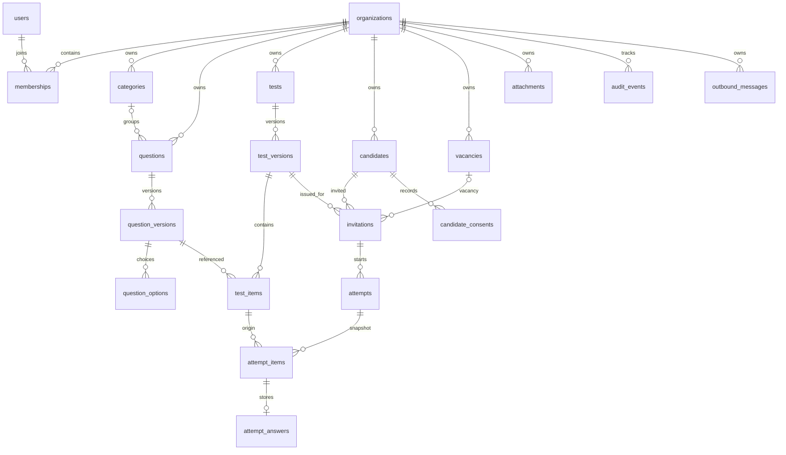
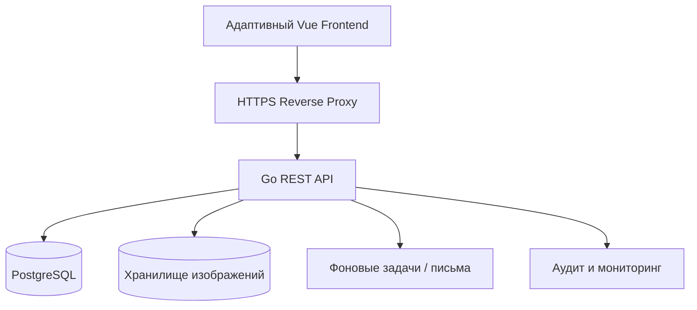

# Кадровый тестер Web 2.0 — логическая модель и архитектура

Это справочная схема к документу `ТЗ_Кадровый_тестер_Web_2.0.docx`.
Физическая модель приведена в `01_schema_postgresql.sql`. Названия — имена таблиц PostgreSQL.

## Изоляция организаций

- Каждая предметная таблица хранит `organization_id`.
- Составные внешние ключи ограничивают связи внутри tenant.
- Backend обязан проверять tenant и роль на каждом запросе.
- PostgreSQL RLS применяется как дополнительная защита после отдельной настройки DB-роли, tenant-context и безопасного разрешения приглашений.
- В MVP создаётся одна организация. В SaaS можно создавать дополнительные без перестройки общей схемы.

## Безопасность кандидата

- Привязка к тесту: токен приглашения, в базе только SHA-256/HMAC хеш.
- Время начала и дедлайн хранятся на сервере.
- Кандидату отправляются вопросы без `question_options.is_correct` и `question_versions.explanation`.
- При старте фиксируются версии теста/вопросов и порядок заданий.
- `submit` должен быть идемпотентным; поздние ответы отклоняются.
- При восстановлении страницы отображается последняя подтверждённая версия ответа.

## Логические части приложения

## Что не покрывает SQL-схема без дополнительной логики

1. Проверку неизменяемости опубликованных версий — реализовать сервисом публикации и запретом UPDATE для published-редакций.
2. Проверку числа правильных вариантов по типу вопроса — транзакционной валидацией в сервисе редактора.
3. Контроль принадлежности test_item к версии теста, которая находится в попытке — транзакционной проверкой.
4. Действительное включение и тестирование RLS — конфигурацией роли подключения и безопасного контекста, после тестирования.
5. Запланированные миграции, создание учётных записей и SMTP — отдельными модулями разработки.
